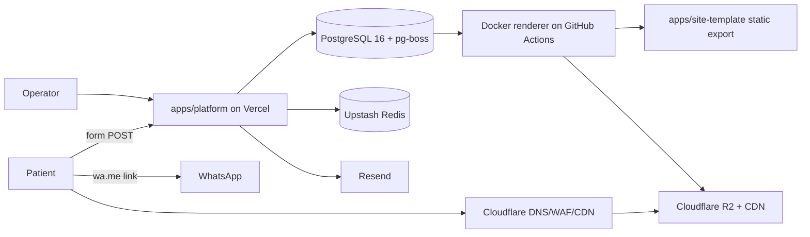
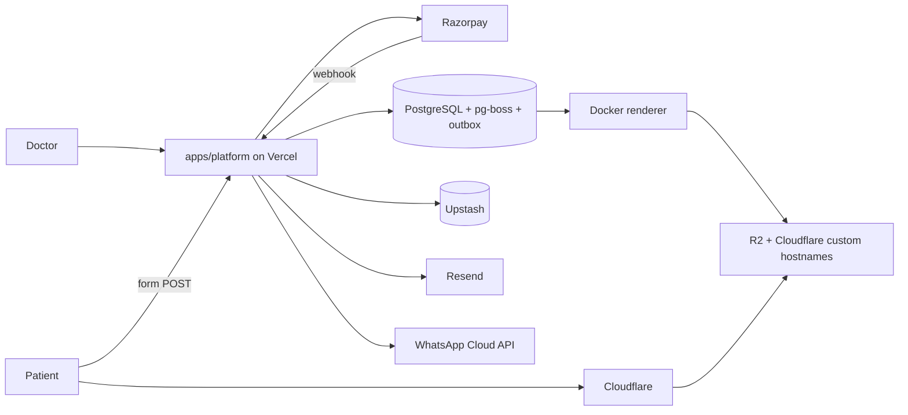
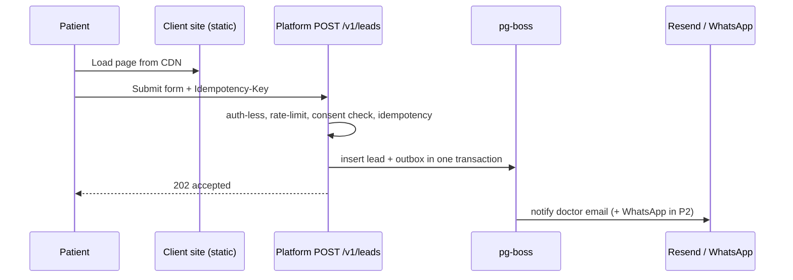
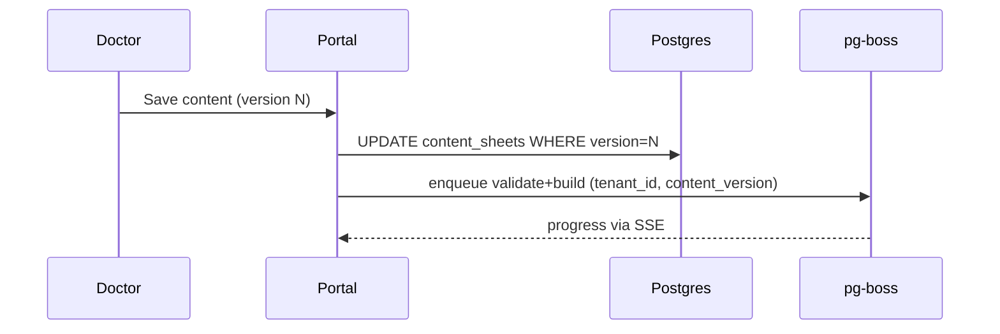
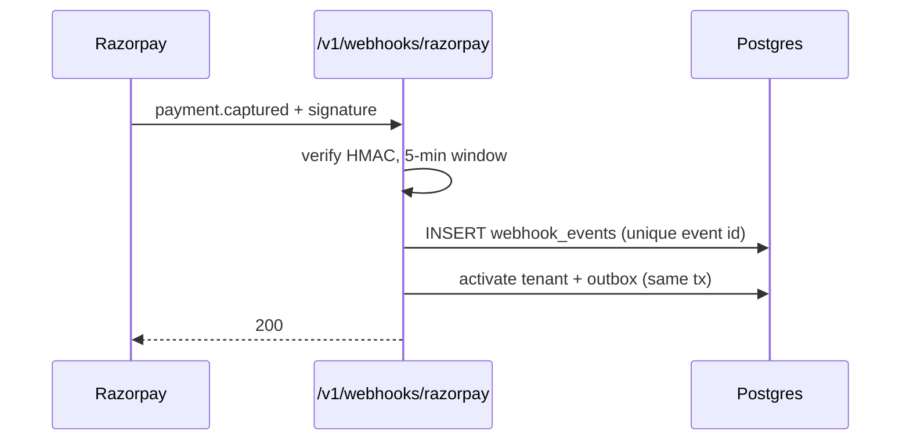
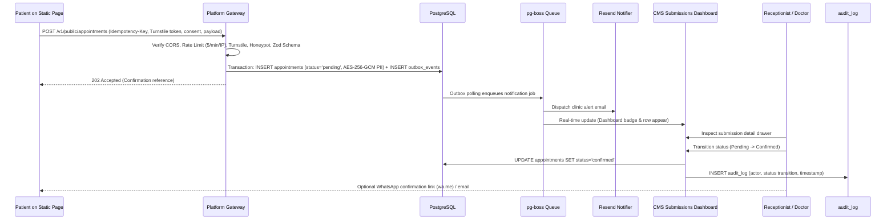
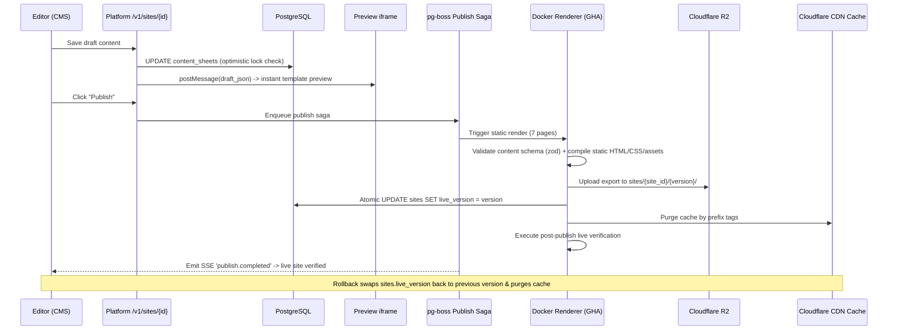

# 03 — Architecture

## 1. Context & containers

P1 factory (operators only):

P2 self-serve (adds doctors, Razorpay, WhatsApp Cloud API):

## 2. Request flows

### Professional Clinic Data Flows

## 3. Multi-tenancy & Architectural Fit (ADR-201)

Shared Postgres schema; every tenant-owned table has `tenant_id uuid not null`; row-level security policy `USING (tenant_id = current_setting('app.tenant_id')::uuid)`; the platform sets it per transaction (`SET LOCAL`). Operators/superadmin use a separate role with `BYPASSRLS` limited to server code. Acceptance: isolation test creates two tenants and asserts zero cross-reads on every table (13 § 1). DB-per-tenant rejected (cost and migrations at 1,000 tenants; ADR-002).

### Architectural Fit for Professional Clinic (ADR-201)
The "Custom backend and database configuration" in the ₹18,999 Professional Clinic plan is delivered as a **per-clinic isolated slice of the existing control plane**, not as a separate virtual machine or database cluster per clinic:
1. **Tenant Slice:** One tenant row with `plan = 'professional'`, possessing its own RLS-isolated data in shared PostgreSQL (`tenants`, `users`, `sites`, `domains`, `content_sheets`, `leads`, `appointments`, `appointment_events`, `enquiries`, `posts`, `faqs`, `testimonials`, `clinic_settings`, `usage_counters`, `audit_log`).
2. **Clinic Backend APIs:** The clinic's backend is the tenant-scoped set of `/v1` APIs in `apps/platform` (auth/2FA, CMS submissions, appointments, enquiries, blog, settings), configured per clinic through settings (hours, slots, notification emails, spam rules, enabled 7-page set).
3. **Static Public Site:** The public site stays statically generated (`apps/site-template`, up to 7 pages) with zero server code and zero database connection of its own. It is compiled by the Docker renderer and hosted on Cloudflare R2 + CDN.
4. **Dynamic Touchpoints:** Patient forms call the control plane via versioned public endpoints (`POST /v1/public/appointments`, `POST /v1/public/enquiries`, `GET /v1/public/availability`) protected by Cloudflare Turnstile, honeypot, rate limiting, and server-side Zod validation. Static fallbacks (`tel:`, `wa.me:`, `mailto:`) activate if the API is unreachable.
5. **Margin Preservation:** A dedicated managed Postgres per clinic would multiply operational overhead for a 2-person team and cost more per year than the ₹18,999 plan nets.
6. **Upgrade Path (ADR-202):** All tenant data is strictly keyed by `tenant_id` and RLS-enforced, enabling clean export into a standalone dedicated database if the clinic purchases the "Dedicated Database" enterprise add-on.

## 4. Site generation & delivery

Content sheet saved → zod validation (`packages/content-schema`) → pg-boss `build` job → renderer (GitHub Actions Docker) runs static export → asset pipeline (sharp → AVIF/WebP) → upload to R2 prefix `sites/{site_id}/{version}/` → atomic pointer swap in `sites.live_version` → purge by prefix → Cloudflare custom hostname + SSL (SSL for SaaS) → post-publish verification (06 § 1). Acceptance: build < 90 s, deploy swap < 5 s.

## 5. System Design Matrix

| SD | Concept | Decision (≤ 12 words) | File | Phase |
|---|---|---|---|---|
| SD-001 | Idempotency keys | Idempotency-Key header; Redis snapshot 24 h; DB unique backstop | 07 | P1 |
| SD-002 | Rate limiting | Upstash sliding window per IP, tenant and route | 10 | P1 |
| SD-003 | Reverse proxy | Cloudflare and Vercel proxy; no self-run nginx | 03 | P1 |
| SD-004 | Connection pooling | PgBouncer transaction mode; one shared pool per runtime | 03 | P1 |
| SD-005 | N+1 queries | Drizzle joins, batch loaders, query-count test guard | 03 | P1 |
| SD-006 | Caching strategies | Static-first; Redis for hot reads only | 03 | P1 |
| SD-007 | Cache invalidation | Content-version keys; purge by prefix on publish | 03 | P1 |
| SD-008 | Load balancing | Platform-managed balancing; queue fan-out for workers | 03 | P1 |
| SD-009 | API gateway | Route Handler middleware chain: auth, limit, idempotency | 03 | P1 |
| SD-010 | Timeouts | Per-dependency budget table; AbortSignal everywhere | 09 | P1 |
| SD-011 | Retries | Retry idempotent reads and keyed writes only | 09 | P1 |
| SD-012 | Exponential backoff | min(30 s, 0.2 s × 2^n) with full jitter | 09 | P1 |
| SD-013 | Circuit breakers | opossum per dependency; open at 5 failures in 30 s | 09 | P1 |
| SD-014 | Race conditions | Idempotency, optimistic locks, advisory locks per hazard | 09 | P1 |
| SD-015 | Deadlocks | Fixed lock order; statement_timeout 5 s | 09 | P1 |
| SD-016 | Memory leaks | No module caches; stream builds; heap alarm | 09 | P1 |
| SD-017 | Webhooks | HMAC verify, 5-minute window, idempotent webhook_events | 07 | P1 |
| SD-018 | CORS | Dynamic allowlist from domains table; never wildcard | 10 | P1 |
| SD-019 | Secrets management | Vercel encrypted env vars; gitleaks; quarterly rotation | 10 | P1 |
| SD-020 | Database indexes | Per-query b-tree, GIN, partial indexes | 04 | P1 |
| SD-021 | Query optimization | Keyset pagination, projection, EXPLAIN gate | 04 | P1 |
| SD-022 | Read replicas | One replica for reporting only | 04 | P2 |
| SD-023 | Database migrations | SQL migrations, expand-migrate-contract | 04 | P1 |
| SD-024 | Schema versioning | content-schema semver plus per-site schema_version | 04 | P1 |
| SD-025 | Optimistic locking | version column on content_sheets | 04 | P1 |
| SD-026 | Pessimistic locking | SELECT FOR UPDATE in payment reconciliation | 04 | P2 |
| SD-027 | Distributed locks | Upstash lock with TTL and fencing token | 04 | P1 |
| SD-028 | Sharding | Tenant-hash shards at 10k+ tenants | 04 | P3 |
| SD-029 | Partitioning | Monthly range partitions for leads, audit_log | 04 | P2 |
| SD-030 | Replication | Managed streaming replication; lag budget 5 s | 04 | P2 |
| SD-031 | Leader election | Advisory lock in P1/P2; Kubernetes Lease in P3 | 02 | P1 |
| SD-032 | CAP theorem | Postgres consistent; Redis and CDN favor availability | 02 | P1 |
| SD-033 | Eventual consistency | Allowed for analytics and caches; never payments | 04 | P1 |
| SD-034 | Distributed transactions | Avoid two-phase commit; transactional outbox | 03 | P1 |
| SD-035 | Saga pattern | Publish pipeline as orchestrated saga with compensations | 03 | P1 |
| SD-036 | Message queues | pg-boss queues, per-tenant concurrency 1 | 03 | P1 |
| SD-037 | Pub/sub | LISTEN/NOTIFY for workers; Redis channel for SSE | 03 | P2 |
| SD-038 | Event-driven architecture | Outbox, dispatcher, idempotent handlers | 03 | P1 |
| SD-039 | Dead letter queues | pg-boss dead-letter queues; alert after 15 minutes | 06 | P1 |
| SD-040 | Backpressure | Queue-depth caps; shed low-priority jobs first | 06 | P1 |
| SD-041 | Cron jobs | GitHub scheduled workflows plus pg-boss schedules | 12 | P1 |
| SD-042 | SQL injection | Drizzle typed queries; raw SQL strings lint-banned | 10 | P1 |
| SD-043 | XSS | React escaping, strict CSP, sanitized markdown only | 10 | P1 |
| SD-044 | CSRF | SameSite=Lax plus double-submit token | 10 | P1 |
| SD-045 | SSRF | No user URLs fetched; allowlisting egress proxy | 10 | P2 |
| SD-046 | OAuth | Google sign-in with PKCE, state, nonce | 10 | P2 |
| SD-047 | JWT rotation | 15-minute access; rotating refresh with reuse detection | 10 | P1 |
| SD-048 | IAM | Four-role RBAC plus Postgres RLS backstop | 10 | P1 |
| SD-049 | TLS | Cloudflare Full (strict), HSTS, TLS 1.2 minimum | 10 | P1 |
| SD-050 | Encryption at rest | Disk encryption plus AES-256-GCM for PII columns | 10 | P1 |
| SD-051 | Encryption in transit | TLS on every hop including Postgres and Redis | 10 | P1 |
| SD-052 | WAF | Cloudflare managed OWASP ruleset, tuned per route | 10 | P1 |
| SD-053 | DDoS protection | Cloudflare free posture; static sites absorb attacks | 10 | P1 |
| SD-054 | WebSockets | Rejected; serverless cannot hold connections | 08 | P3 |
| SD-055 | SSE | Build-progress stream with polling fallback | 08 | P2 |
| SD-056 | Long polling | Fallback when SSE is blocked | 08 | P2 |
| SD-057 | gRPC | Not for browsers; internal services in P3 | 03 | P3 |
| SD-058 | HTTP/2 and HTTP/3 | CDN-provided; enable H3; no application work | 03 | P1 |
| SD-059 | TCP vs UDP | All TCP/TLS; QUIC only at the edge | 03 | P1 |
| SD-060 | DNS | Cloudflare zones; TTL 300 s; propagation runbook | 03 | P1 |
| SD-061 | Docker | Containerize renderer and Playwright runner in CI | 12 | P1 |
| SD-062 | Kubernetes | Specified manifests; deployed only at cost trigger | 12 | P3 |
| SD-063 | Helm charts | One chart, per-environment values, external-secrets | 12 | P3 |
| SD-064 | Service discovery | Env-var URLs and DNS; Kubernetes Services in P3 | 12 | P1 |
| SD-065 | CI/CD | GitHub Actions PR and release pipelines | 12 | P1 |
| SD-066 | Build caching | Turborepo remote cache plus pnpm store cache | 12 | P1 |
| SD-067 | Infrastructure as code | No console changes; everything in Terraform | 12 | P1 |
| SD-068 | Terraform | Modules for Cloudflare, Postgres host, Upstash, GitHub | 12 | P2 |
| SD-069 | Feature flags | DB table, Redis cache, 90-day cleanup | 12 | P2 |
| SD-070 | Blue-green deployment | Rejected for platform; Vercel aliases emulate it | 12 | P1 |
| SD-071 | Canary releases | Feature-flag cohort canary with 30-minute watch | 12 | P2 |
| SD-072 | Rolling deployments | Kubernetes rolling updates in P3 only | 12 | P3 |
| SD-073 | Rollbacks | Vercel instant rollback; automatic at 2% errors | 12 | P1 |
| SD-074 | Health checks | /api/health liveness, /api/ready readiness | 12 | P1 |
| SD-075 | Liveness and readiness probes | Probe specs for renderer image and P3 Kubernetes | 12 | P3 |
| SD-076 | Dependency hell | Strict lockfile, weekly Renovate, documented overrides | 12 | P1 |
| SD-077 | API versioning | URL /v1; Sunset header; six-month deprecation | 07 | P1 |
| SD-078 | Semantic versioning | SemVer for API and content-schema | 07 | P1 |
| SD-079 | Garbage collection | 1024 MB functions; stream builds; heap alarm | 02 | P1 |
| SD-080 | Thread safety | No shared mutable state; worker_threads only if needed | 02 | P1 |
| SD-081 | Autoscaling | Vercel and Postgres host autoscale; HPA in P3 | 03 | P1 |
| SD-082 | Horizontal scaling | Stateless functions; worker scale-out by queue depth | 03 | P1 |
| SD-083 | Vertical scaling | Raise Postgres compute and function memory first | 03 | P1 |
| SD-084 | CDN | Cloudflare tiered cache; hit ratio at least 95% | 03 | P1 |
| SD-085 | Edge caching | Cache-Control policy per asset class | 03 | P1 |
| SD-086 | Cost optimization | Cost model at 10/100/1,000 sites; self-host trigger | 02 | P1 |
| SD-087 | Cold starts | Slim bundles; Node runtime; warm-up ping | 02 | P1 |
| SD-088 | Serverless limits | 60 s duration; builds run in the renderer | 02 | P1 |
| SD-089 | Latency | Per-hop budgets; API P99 under 300 ms | 03 | P1 |
| SD-090 | Throughput | Design load 500 leads/min with 10x headroom | 03 | P1 |
| SD-091 | P99 latency | Track P99 per route; alert at 300 ms | 03 | P1 |
| SD-092 | Tail latency | Timeouts, warm pool, cached reads; no hedging | 03 | P1 |
| SD-093 | Network partitions | Park jobs; degrade per decision table | 09 | P1 |
| SD-094 | Clock skew | Order by database now(); JWT tolerance 60 s | 09 | P1 |
| SD-095 | Multi-region deployment | Single region in P1/P2; read-region design in P3 | 03 | P3 |
| SD-096 | Failover | Static sites independent; Postgres host failover | 09 | P1 |
| SD-097 | Backups | PITR plus git content plus DNS exports; RPO 24 h | 14 | P1 |
| SD-098 | Disaster recovery | Rebuild-from-IaC runbook; RTO 4 h | 14 | P1 |
| SD-099 | Chaos engineering | Quarterly GameDay with five scenarios | 13 | P2 |
| SD-100 | Logging | Structured JSON, request ID, PII scrubbing | 14 | P1 |
| SD-101 | Monitoring | Dashboard inventory in Better Stack | 14 | P1 |
| SD-102 | Distributed tracing | OpenTelemetry, traceparent, 10% sampling | 14 | P2 |
| SD-103 | Metrics | RED plus business metrics | 14 | P1 |
| SD-104 | Alerting | Sev-1 to Sev-3 severity table | 14 | P1 |
| SD-105 | Observability | Logs, traces, metrics correlated by trace ID | 14 | P2 |
| SD-106 | SLIs | Formula catalogue per user journey | 14 | P1 |
| SD-107 | SLOs | 99.9% availability; 99% of leads under 60 s | 14 | P1 |
| SD-108 | Error budgets | Burn above 50% pauses feature work | 14 | P1 |
| SD-109 | Production incidents | Severity levels and timeline template | 14 | P1 |
| SD-110 | On-call | Business-hours rotation of two people | 14 | P1 |
| SD-111 | Postmortems | Blameless, written within 48 hours | 14 | P1 |

## 6. Edge & traffic deep dives

**(SD-003) Reverse proxy.** *Meaning:* Cloudflare proxies all client domains and `api.doctorsite.in`; Vercel fronts `apps/platform`. *Decision:* no nginx/Envoy of our own; ours remain: Cloudflare page rules, Worker that maps `Host` to `sites/{site_id}/{live_version}/` in R2. Rejected: self-run proxy (ops burden for two people). *Sketch:* `host → KV lookup (domains) → R2 key prefix`, KV TTL 60 s. *Failure:* unknown host serves another tenant; reveals as `worker_host_miss_total` > 0 and 404 spikes. *Verify:* 13 § 2 (E2E journeys); 14 § 1 (DNS/SSL items).

**(SD-004) Connection pooling.** *Meaning:* Postgres connections from serverless functions. *Decision:* PgBouncer in transaction mode (host-provided pooler), pool size 10 per function instance via a single module-level pool; `SET LOCAL` only (RLS-safe in transaction mode). Rejected: per-function-invocation pools (exhaust 100 connections). *Sketch:* `DATABASE_URL=postgres://…:6432/app?sslmode=require`, `max: 10, idleTimeoutMillis: 10000`. *Failure:* `too many connections`; reveals as E-4001 and `db_connections_active` > 80% of max. *Verify:* 13 § 5; 14 § 3 (SD-101).

**(SD-005) N+1 queries.** *Meaning:* per-row queries in lists (leads with events, sites with domains). *Decision:* Drizzle `with` relations and explicit joins; DataLoader-style batching `inArray(ids)` for portal lists; test helper counts queries per request (max 5 on list routes). Rejected: lazy ORM loading. *Sketch:* `db.query.leads.findMany({ with: { events: true }, limit: 50 })`. *Failure:* list route P99 climbs with page size; reveals as `db_queries_per_request` > 5. *Verify:* 13 § 1 (integration).

**(SD-006) Caching strategies.** *Meaning:* what is cached where. *Decision:* static-first (client sites are files); Redis only for hot reads (feature flags, domain→site lookups, rate-limit state); key taxonomy `flag:{key}`, `dom:{host}`, `idem:{tenant}:{key}`, `rl:{route}:{id}`; no cache for payments or lead lists. Rejected: caching Postgres query results generally. *Failure:* stale flag keeps a bad feature on; reveals as flag-read mismatch metric. *Verify:* 13 § 1; 14 § 3.

**(SD-007) Cache invalidation.** *Meaning:* making publishes visible. *Decision:* immutable content-version paths (`/{version}/…`) plus a pointer swap; HTML `no-cache`, assets `immutable`; Cloudflare purge by prefix after swap; Redis `dom:{host}` deleted in the same step. Rejected: TTL-only expiry. *Sketch:* `DELETE dom:{host}; POST /zones/{id}/purge_cache {prefixes:[…]}`. *Failure:* old site served after publish; reveals as post-publish check mismatch (06 § 1). *Verify:* 14 § 1 (live version check).

**(SD-008) Load balancing.** *Meaning:* spreading traffic and jobs. *Decision:* Cloudflare and Vercel balance inbound; workers are competing consumers on pg-boss (`SKIP LOCKED`) with fan-out by tenant (concurrency 1 per tenant). Rejected: self-managed load balancer. *Failure:* one worker starves; reveals as queue age P95 > 120 s. *Verify:* 13 § 5.

**(SD-009) API gateway.** *Meaning:* common edge logic. *Decision:* Route Handlers wrapped by `withGateway()` in `apps/platform/src/lib/gateway.ts`: request ID → rate limit → auth/RBAC → idempotency → handler → error envelope. Rejected: Kong/AWS API Gateway (extra hop/cost). *Sketch:* `export const POST = withGateway({ auth:'none', limit:'leads', idem:true }, handler)`. *Failure:* a route missing the wrapper; reveals through lint rule `require-gateway` in CI. *Verify:* 13 § 1.

## 7. Async & consistency deep dives

**(SD-034) Distributed transactions.** *Meaning:* tenant activation touches Postgres, Cloudflare, email. *Decision:* no two-phase commit; the DB transaction writes state plus `outbox_events` rows; the dispatcher performs external calls afterwards. Rejected: XA/2PC. *Failure:* state saved, effect lost; reveals as outbox rows older than 5 min unprocessed. *Verify:* 13 § 4; 14 § 3.

**(SD-035) Saga pattern.** *Meaning:* the publish pipeline. *Decision:* orchestrated saga in `apps/platform/src/pipeline/publish.ts`: steps validate → build → upload → swap → hostname/SSL → verify; compensations: restore previous `live_version`, delete orphan prefix, notify operator. Rejected: choreography (hard to debug for two people). *Sketch:* `step(name, run, compensate)` persisted in `pipeline_runs` (JSONB state on `sites`). *Failure:* half-published site; reveals as `pipeline_stuck_total` (no step change in 10 min). *Verify:* 13 § 4 (worker crash mid-build, 13 § 6).

**(SD-036) Message queues.** *Meaning:* pg-boss queues: `validate`, `build`, `publish`, `notify`, `sweep`. *Decision:* visibility (lock) timeout 120 s for `build`, 30 s others; `singletonKey = tenant_id:content_version`; Postgres chosen over Redis queues for transactional enqueue. Rejected: BullMQ. *Failure:* jobs lost or stuck; reveals as queue depth and oldest-job age. *Verify:* 13 § 1.

**(SD-037) Pub/sub.** *Meaning:* fan-out of status. *Decision:* Postgres `LISTEN/NOTIFY` channel `job_done` wakes workers; Redis pub/sub channel `build:{site_id}` feeds SSE streams; subscribers: SSE route (progress), notifier worker (emails). Rejected: Kafka. *Failure:* missed progress events; UI falls back to polling (08 § 4). *Verify:* 13 § 2.

**(SD-038) Event-driven architecture.** *Meaning:* events in 05 § 2. *Decision:* write event to `outbox_events` in the same transaction, dispatcher (every 5 s via pg-boss schedule) delivers to handlers, handlers idempotent by `event_id`. *Failure:* duplicates or gaps; reveals as `outbox_lag_seconds` P95 > 30 s. *Verify:* 13 § 4.

## 8. Protocol deep dives

**(SD-057) gRPC.** *Meaning:* RPC protocol. *Decision:* not used in P1/P2 (browsers cannot speak it natively; REST over Route Handlers suffices); P3 internal services (renderer, notifier) may use gRPC over cluster DNS. Rejected: gRPC-web. *Sketch:* `.proto` kept under `packages/config/proto/` only in P3. *Failure:* premature adoption slows delivery; tracked as ADR needed. *Verify:* review gate in 12 § 1.

**(SD-058) HTTP/2 and HTTP/3.** *Meaning:* transport versions. *Decision:* Cloudflare enables H2 + H3 for client domains; Vercel serves H2; nothing in app code. Implication: no domain sharding; avoid bundling hacks. *Failure:* H3 blocked on some networks; clients fall back to H2 automatically. *Verify:* 14 § 1 (protocol check item).

**(SD-059) TCP vs UDP.** *Meaning:* transport. *Decision:* everything is TCP/TLS; QUIC (UDP) exists only between browser and Cloudflare; DNS uses UDP/53 handled by Cloudflare. Rejected: custom UDP. *Failure:* none expected; monitored through edge error rate. *Verify:* 14 § 3.

**(SD-060) DNS.** *Meaning:* zone layout. *Decision:* `doctorsite.in` zone on Cloudflare; client domains either (a) registered by us with Cloudflare Registrar-class registrar and zone on our account, or (b) client-owned with CNAME to `sites.doctorsite.in` (custom hostname). Records per client domain: `@` and `www` CNAME (proxied), `_acme-challenge` managed by Cloudflare, SPF/DKIM only for notification mail from `mail.doctorsite.in`. TTL 300 s; propagation playbook: check `dig @1.1.1.1`, `@8.8.8.8`, wait ≤ 1 h, escalate to registrar. *Failure:* expired/misrouted DNS equals site down; reveals as synthetic probe failure within 5 min. *Verify:* 14 § 1; 14 § 5.

## 9. Scaling deep dives

**(SD-081) Autoscaling.** *Meaning:* capacity follow load. *Decision:* Vercel scales functions (limit concurrency 100 on Pro, estimate); Postgres host autoscaling disabled (fixed compute, raise manually); Upstash scales automatically; P3 Kubernetes HPA on CPU 70% and queue depth (12 § 6). *Failure:* concurrency cap reached; reveals as 429/503 from Vercel and alert at 80% of cap. *Verify:* 13 § 5.

**(SD-082) Horizontal scaling.** *Meaning:* add instances. *Decision:* all handlers stateless (state in Postgres/Redis); worker scale-out by increasing concurrent drain invocations when queue depth > 50. *Failure:* sticky state breaks scale-out; reveals in multi-instance integration test. *Verify:* 13 § 1.

**(SD-083) Vertical scaling.** *Meaning:* bigger boxes. *Decision:* first lever for Postgres compute (2 → 4 vCPU at CPU > 70% for 1 h) and function memory (1024 → 1536 MB at heap > 80%). *Failure:* surprise cost; covered by monthly cost report. *Verify:* 12 § 9.

**(SD-084) CDN.** *Meaning:* Cloudflare cache topology. *Decision:* tiered cache on; Worker + R2 origin; hit-ratio target ≥ 95% (measured per zone). *Failure:* low hit ratio raises R2 cost and latency; alert < 90%. *Verify:* 14 § 3.

**(SD-085) Edge caching.** *Meaning:* Cache-Control per class.

| Asset class | Cache-Control | Edge TTL |
|---|---|---|
| HTML | `public, max-age=0, must-revalidate` | 60 s, purged on publish |
| Hashed JS/CSS/fonts | `public, max-age=31536000, immutable` | 1 year |
| Images (AVIF/WebP) | `public, max-age=31536000, immutable` | 1 year |
| sitemap/robots | `public, max-age=3600` | 1 h |
| API responses | `no-store` | none |

*Failure:* stale HTML; reveals via post-publish version check. *Verify:* 14 § 1.

**(SD-089–SD-092) Latency family.** *Meaning:* **(SD-089)** latency, **(SD-090)** throughput, **(SD-091)** P99, **(SD-092)** tail. *Decision:* budgets for `POST /v1/leads` (ap-south-1 to user ≈ 40–120 ms network): edge 20 ms + gateway 15 ms + Redis 10 ms + Postgres 25 ms + serialize 5 ms = 75 ms P50; P99 < 300 ms. **(SD-090)** design load 500 leads/min (8.3/s) with 10x headroom = 83/s; queue absorbs bursts. **(SD-091)** P99 tracked per route with histogram buckets 50/100/200/300/500/1000 ms; alert at P99 > 300 ms for 10 min. **(SD-092)** tactics: timeouts per dependency (09 § 2), warm-up ping, cached reads, no hedged requests (cost), async notifications off the request path. *Failure:* tail grows from cold starts or slow Redis; reveals as P99/P50 ratio > 5. *Verify:* 13 § 5 (k6 thresholds `p(99)<300`).

**(SD-095) Multi-region deployment.** *Meaning:* more than one region. *Decision:* P1/P2 single region (ap-south-1 nearest; Vercel function region `bom1`); accepted: control-plane regional outage = no lead intake until recovery, mitigated by client-side outbox and mailto fallback (09 § 6). P3 design: read replica + Redis in second region, writes still single-primary. Rejected: active-active (conflict handling cost). *Failure:* regional outage; reveals through probes from two external locations. *Verify:* 14 § 5 (DR drill).

## 10. Failure propagation map

| Component failure | User impact | Mitigation | Doc |
|---|---|---|---|
| Platform down | Portal down; client sites up; form falls back | Static-first, outbox fallback | 09 § 6 |
| Postgres down | No logins/saves/leads | Host failover, queue parked | 09 § 5 |
| Redis down | Rate limits fail-open (reads), idempotency via DB | Breaker, DB unique | 09 § 3 |
| Renderer/GitHub down | No new builds | Jobs queued; operator notified | 06 § 2 |
| Resend down | Lead emails delayed | Retry + WhatsApp link + inbox | 09 § 2 |
| Razorpay down | No new payments | Retry page; webhooks replay | 07 § 4 |
| Cloudflare down | Sites unreachable | Status comms; no alternative in P1 | 14 § 4 |
