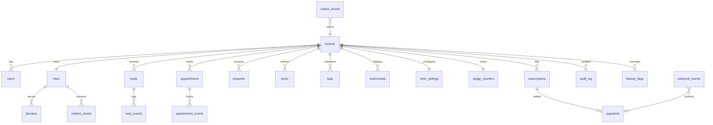

# 04 — Data Model

Engine: PostgreSQL 16, standard SQL only (no vendor extensions beyond `pgcrypto`, `pg_trgm`). Schema defined in Drizzle (`apps/platform/src/db/schema.ts`), migrations as plain `.sql` in `apps/platform/drizzle/`.

## 1. ER diagram

## 2. Table specifications

| Table | Purpose | Key columns | Owner | Retention |
|---|---|---|---|---|
| tenants | One paying clinic | id uuid pk, slug text unique, name, status (`draft/active/suspended/offboarded`), created_at timestamptz | Platform | Until offboarding + 90 d |
| users | Logins | id, tenant_id, email citext unique, role enum(`superadmin,operator,tenant_owner,tenant_staff`), totp_secret_enc text, totp_enabled bool default false, last_login_at | Platform | With tenant |
| sites | One site per tenant | id, tenant_id unique, plan enum(`basic,growth,professional`) default `basic`, live_version int, schema_version text, theme enum(`green,teal`), status | Pipeline | With tenant |
| domains | Hostnames | id, site_id, host text unique, kind (`registered/byo`), cf_hostname_id, ssl_status, expires_on date | Pipeline | With tenant |
| content_sheets | Versioned content | id, site_id, version int, data jsonb, schema_version, created_by, created_at, `unique(site_id, version)` | Wizard/operator | All versions 12 months; live + 5 prior forever |
| leads | Patient enquiries | id, tenant_id, created_at, channel enum(`form,call,whatsapp`), name_enc bytea, phone_enc bytea, email_enc bytea, message_enc bytea, consent_at, idempotency_key | Lead API | 24 months (DECISION-NEEDED) |
| lead_events | Delivery trail | id, lead_id, kind (`received,email_sent,wa_sent,failed`), at timestamptz default now() | Notifier | With lead |
| appointments | Clinic booking requests | id, tenant_id, created_at, patient_name_enc bytea, patient_phone_enc bytea, patient_email_enc bytea, service_name text, preferred_date date, preferred_time_slot text, status enum(`pending,confirmed,completed,cancelled`) default `pending`, notes text, consent_at timestamptz, idempotency_key text unique, ip_hash text | Appointments API | 24 months, then archive |
| appointment_events | Status audit trail | id, appointment_id, tenant_id, actor_id, from_status text, to_status text, note text, created_at timestamptz | Appointments API | With appointment |
| enquiries | Patient clinic messages | id, tenant_id, created_at, name_enc bytea, phone_enc bytea, email_enc bytea, message_enc bytea, service text, status enum(`pending,confirmed,completed,cancelled`) default `pending`, consent_at timestamptz, idempotency_key text unique | Enquiries API | 24 months |
| posts | Clinic blog articles | id, tenant_id, title text, slug text, excerpt text, content_json jsonb, cover_image_url text, published_at timestamptz, is_published bool default false, seo_title text, seo_description text, created_at timestamptz, updated_at timestamptz, `unique(tenant_id, slug)` | Blog CMS | With tenant |
| faqs | Clinic Q&A items | id, tenant_id, question text, answer text, category text, display_order int, is_active bool default true, created_at timestamptz | FAQ CMS | With tenant |
| testimonials | Patient reviews & consent | id, tenant_id, patient_initials text, review_text text, rating int, treatment text, consent_recorded bool default false, moderation_status enum(`draft,approved,archived`) default `draft`, display_order int, created_at timestamptz | Reviews CMS | With tenant |
| clinic_settings | Operating config | id, tenant_id unique, operating_hours jsonb, slot_interval_minutes int default 30, max_daily_slots int default 40, notification_emails text[], spam_threshold int default 5, enabled_pages text[], created_at timestamptz, updated_at timestamptz | Settings CMS | With tenant |
| usage_counters | Quota meters | tenant_id pk, period_start date, appointment_count int default 0, enquiry_count int default 0, storage_bytes bigint default 0, content_updates_used int default 0, updated_at timestamptz | Metering | 8 years |
| subscriptions | Plan state | id, tenant_id, plan enum(`basic,growth,professional`), status, current_period_end date, renewal_price_paise int (299900 for basic, 599900 for growth, 999900 for professional; See 01_PRD.md § 2) | Billing | 8 years (tax) |
| payments | Money records | id, subscription_id, razorpay_payment_id unique, amount_paise int, gst_paise int, status, idempotency_key unique | Billing | 8 years |
| webhook_events | Inbound webhooks | id, provider, event_id, signature_ok bool, payload jsonb, received_at, processed_at, `unique(provider,event_id)` | Webhook route | 90 days |
| outbox_events | Reliable events | id, tenant_id, type, payload jsonb, created_at, dispatched_at | Dispatcher | 30 days after dispatch |
| audit_log | Immutable actions | id, tenant_id, actor_id, action, target, at; append-only (no UPDATE/DELETE grants) | Platform | 24 months, then archive |
| feature_flags | Flags | key text pk, enabled bool, rollout_pct int, tenant_ids uuid[] | Platform | Until removed |

Content sheet `data` is typed JSONB validated by `packages/content-schema` (zod) before every write.

## 3. Indexing & queries

**(SD-020) Database indexes (scan vs seek).** *Meaning:* indexes for hot queries in `apps/platform/src/db/queries/`. *Decision:*

| Query | Index |
|---|---|
| Leads inbox by tenant, newest first | `CREATE INDEX leads_tenant_created_idx ON leads (tenant_id, created_at DESC, id DESC)` |
| Appointments inbox by tenant, created desc | `CREATE INDEX appointments_tenant_created_idx ON appointments (tenant_id, created_at DESC, id DESC)` |
| Appointments by date and status (Today OPD) | `CREATE INDEX appointments_tenant_date_idx ON appointments (tenant_id, preferred_date, status)` |
| Enquiries inbox by tenant, created desc | `CREATE INDEX enquiries_tenant_created_idx ON enquiries (tenant_id, created_at DESC, id DESC)` |
| Blog posts by slug | `CREATE UNIQUE INDEX posts_tenant_slug_idx ON posts (tenant_id, slug)` |
| FAQs by display order | `CREATE INDEX faqs_tenant_order_idx ON faqs (tenant_id, display_order) WHERE is_active = true` |
| Testimonials approved by order | `CREATE INDEX testimonials_tenant_idx ON testimonials (tenant_id, display_order) WHERE moderation_status = 'approved'` |
| Active-tenant lookups | `CREATE INDEX tenants_active_idx ON tenants (slug) WHERE status = 'active'` (partial) |
| Domain expiry sweep | `CREATE INDEX domains_expiry_idx ON domains (expires_on) WHERE ssl_status <> 'removed'` |
| Content lookups inside JSONB (operator search by city) | `CREATE INDEX content_data_gin ON content_sheets USING GIN (data jsonb_path_ops)` |
| Webhook dedupe | unique `(provider, event_id)` |

Rejected: indexing every column (write cost). *Sketch (scan vs seek):* `EXPLAIN ANALYZE SELECT id FROM leads WHERE tenant_id=$1 ORDER BY created_at DESC LIMIT 50;` before index: `Seq Scan on leads (cost=0..4310) Rows Removed 118k, 38 ms`; after: `Index Scan using leads_tenant_created_idx (cost=0.4..9) 0.3 ms` (illustrative estimates). *Failure:* slow inbox and table scans; reveals as `pg_stat_statements` mean time > 50 ms and `seq_scan` ratio > 10% on leads. *Verify:* 13 § 1 (EXPLAIN assertion tests); 14 § 3.

**(SD-021) Query optimization.** *Meaning:* efficient reads. *Decision:* keyset pagination (`WHERE (created_at,id) < ($c,$i)`), column projection (never `select *` on `content_sheets.data` in lists), N+1 banned (See 03 § SD-005), `statement_timeout = 5s`. Before: `select * from leads where tenant_id=$1 offset 10000` (scans 10k rows); after: keyset (constant cost). *Failure:* deep-page latency; reveals as P99 for `GET /v1/leads`. *Verify:* 13 § 5.

## 4. Replication & reads

**(SD-022) Read replicas.** *Meaning:* second Postgres node for reads. *Decision:* P2 one read replica for reporting/exports only; never read there: payments, auth, idempotency checks, anything followed by a write. Rejected: replicas for the lead inbox (lag confuses users). *Sketch:* `REPORTING_DATABASE_URL` separate env var. *Failure:* stale report shown as current; shown with "as of" timestamp; metric `replica_lag_seconds`. *Verify:* 14 § 3.

**(SD-030) Replication.** *Meaning:* how data is copied. *Decision:* managed asynchronous streaming replication; lag budget 5 s (alert > 30 s for 5 min); PITR from WAL archive (14 § 5). Rejected: synchronous replication (latency). *Failure:* lag blocks reports/failover data loss; reveals as lag metric. *Verify:* 14 § 5.

**(SD-033) Eventual consistency.** *Meaning:* which flows may lag.

| Flow | Consistency |
|---|---|
| Payments, subscriptions, tenant status, auth | Strong (primary only) |
| Content save and version | Strong (optimistic lock) |
| Lead creation | Strong; notifications eventual (P95 < 60 s) |
| Analytics, reports, SSE progress, CDN content | Eventual |
| Redis flags/domain lookups | Eventual, TTL 60 s |

*Failure:* eventual path read for money; reveals in review rule "no replica/Redis in billing code". *Verify:* 13 § 4.

## 5. Migrations & schema versioning

**(SD-023) Database migrations.** *Meaning:* schema change without downtime. *Decision:* SQL migration files, applied by CI (12 § 3) with expand → migrate → contract. Worked example, renaming `leads.phone` to `phone_enc`: (1) expand: `ALTER TABLE leads ADD COLUMN phone_enc bytea;` deploy code writing both; (2) migrate: batched backfill 1,000 rows/tx via job; (3) contract (next release): `ALTER TABLE leads DROP COLUMN phone;`. Lock rule: `lock_timeout = 3s`, `CREATE INDEX CONCURRENTLY`. Rejected: big-bang migrations. *Failure:* lock stalls the API; reveals as `pg_locks` waiting > 5 s and 5xx. *Verify:* 13 § 2 (migration test on testcontainers); 14 § 2.

**(SD-024) Schema versioning.** *Meaning:* content-sheet shape changes. *Decision:* `packages/content-schema` SemVer; each site stores `schema_version`; migrators `migrate_1_0_to_1_1.ts` run on read-for-edit; matrix:

| Template | Content schema | Result |
|---|---|---|
| 1.x | 1.x | Compatible |
| 1.x | 2.x | Blocked until migrator runs |

v1.1.0 MINOR bump (Practice Growth support): introduces optional `plan` (`basic` | `growth`, defaults to `basic`) and optional `pages` structure (up to 5 pages: home, about, services, testimonials, contact; appointment request preferences). Backward compatible with v1.0.0 sheets.

*Failure:* build fails for old sheets; reveals as E-2101 in validation job. *Verify:* 13 § 3.

## 6. Locking

**(SD-025) Optimistic locking.** *Meaning:* concurrent content edits. *Decision:* `content_sheets` write is `INSERT … version = N+1` guarded by `UPDATE sites SET head_version = N+1 WHERE id=$1 AND head_version=N`; zero rows → 409 E-1301. UX in 08 § 3. *Failure:* lost updates; reveals as conflict-rate metric and E2E conflict test. *Verify:* 13 § 4.

**(SD-026) Pessimistic locking.** *Meaning:* serialize reconciliation. *Decision:* `SELECT … FROM subscriptions WHERE id=$1 FOR UPDATE` inside the reconciliation transaction (P2), keeping lock-ordering `tenants → subscriptions → payments` (09 § SD-015). Rejected: optimistic for payments (retry storms). *Failure:* double activation; reveals as duplicate `payment_success` events. *Verify:* 13 § 4.

**(SD-027) Distributed locks.** *Meaning:* singleton jobs across instances. *Decision:* Upstash `SET lock:renewal-sweep <token> NX PX 600000`; token is a monotonically increasing fencing counter from Postgres sequence `fence_seq`; writes carry the token and are rejected if older. Advisory lock remains first choice (02 § SD-031). *Failure:* two holders after TTL expiry; reveals as fencing rejections metric. *Verify:* 13 § 4.

## 7. Scale paths

**(SD-028) Sharding.** *Meaning:* split tenants across databases (P3). *Decision:* at 10k+ tenants or primary > 500 GB, route by `hash(tenant_id) % N` via a `tenant_shards` directory in a small catalog DB; connections become per-shard pools; cross-shard queries (operator dashboards) go through the reporting store; transactions stay single-tenant. Rejected: sharding earlier. *Failure:* hot shard; reveals as per-shard CPU skew. *Verify:* 14 § 5 (capacity review).

**(SD-029) Partitioning.** *Meaning:* big append tables. *Decision:* `leads` and `audit_log` range-partitioned monthly (`PARTITION BY RANGE (created_at)`), created 3 months ahead by cron; archival: detach partitions older than 24 months, export to R2 as encrypted Parquet/CSV, then drop. *Failure:* missing future partition rejects inserts; reveals as insert errors, alert on `partitions_ahead < 2`. *Verify:* 12 § 9; 14 § 5.

## 8. PII & DPDP map

| Column | Data | Treatment |
|---|---|---|
| leads.name_enc, phone_enc, email_enc, message_enc | Patient personal data | AES-256-GCM app-level (10 § SD-050) |
| appointments.patient_name_enc, patient_phone_enc, patient_email_enc | Patient appointment contact | AES-256-GCM app-level |
| enquiries.name_enc, phone_enc, email_enc, message_enc | Patient enquiry message | AES-256-GCM app-level |
| users.email | Staff/doctor contact | Plain, access-controlled |
| users.totp_secret_enc | 2FA secret | AES-256-GCM encrypted |
| payments.* | Amounts only; no card data (Razorpay holds it) | Plain |
| audit_log | Actions, no PII bodies | Append-only |

Retention default 24 months for leads, appointments, and enquiries (DECISION-NEEDED: legal review; recommendation 24 months, doctor-configurable shorter). Deletion workflow: request logged → job overwrites `*_enc` with NULL, keeps `id, created_at`, writes audit entry → confirmation within 30 days. Audit immutability: role has INSERT/SELECT only, plus a trigger raising on UPDATE/DELETE.

## 9. Data-source ownership

See 05_DATA_SOURCES.md § 1 (owner per input) and § 3 (source-of-truth rules).

## 10. Quotas & Resource Allowances (ADR-204)

Tracked via `usage_counters` per tenant and enforced on mutations:
- **Submissions quota:** 5,000 appointment + enquiry records per subscription year. At 4,000 (80%), warning banner appears on CMS dashboard. At 5,000 (100%), new public submissions reject with `E-1602` and fall back to `wa.me`/`tel:`.
- **Media storage quota:** 1 GB total storage in Cloudflare R2 bucket (`assets/{tenant_id}/`). Checked on `POST /v1/cms/media/upload`. Warning banner at 800 MB (80%); blocked at 1 GB with `E-1602`.
- **Content updates allowance:** 3 updates per month included in Professional Clinic plan. SLA tracker resets counter on 1st of every month. Additional updates billed as add-on.
