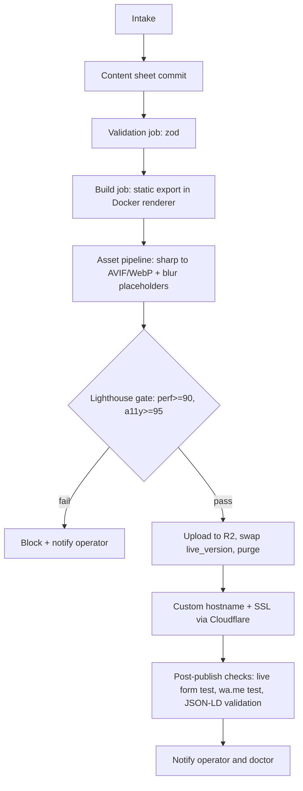

# 06 — Content Pipeline

## 1. Pipeline flow

Acceptance: end-to-end P1 ≤ 4 h wall-clock including human steps; machine portion < 5 min; P2 intake-to-live ≤ 10 min.

## 2. Job machinery

| Job | Queue | Attempts | Backoff | Timeout | Priority |
|---|---|---|---|---|---|
| validate | `validate` | 3 | 2 s base, full jitter | 30 s | 2 |
| build | `build` | 3 | 10 s base | 120 s | 2 |
| publish | `publish` | 5 | 5 s base, cap 60 s | 60 s | 1 (highest) |
| scheduled_publish | `scheduled` | 3 | 5 s base | 60 s | 1 |
| notify | `notify` | 8 | 0.2 s × 2^n cap 30 s | 30 s | 3 |
| sweep | `sweep` | 2 | 60 s | 300 s | 4 |

Rules: per-tenant ordering (concurrency 1 per tenant via `singletonKey = tenant_id`); idempotency key `tenant_id:content_version` (See 07 § 3, SD-001); backoff formula in 09 § SD-012. Heavy `build` dispatches the GitHub Actions renderer and waits for a signed completion callback; a missing callback within 120 s fails the attempt. For Professional Clinic, the Docker renderer builds up to 7 static pages (Home, About, Services, Doctors, Testimonials & FAQ, Blog, Contact). Scheduled publish enqueues a delayed job in pg-boss (`startAfter: targetTime`) that executes atomic pointer swap on `sites.live_version`.

**(SD-039) Dead letter queues.** *Meaning:* poison messages that fail all attempts land in pg-boss dead-letter queues `*_dlq`. *Decision:* each queue has `deadLetter: '<queue>_dlq'`; triage runbook: (1) inspect `SELECT id, name, data, output FROM pgboss.job WHERE name LIKE '%_dlq'`; (2) classify as data error (bad content sheet), code bug, or dependency outage; (3) fix the cause; (4) replay with `boss.resume`/re-insert using same singleton key; (5) record outcome in `audit_log`. Alert when DLQ depth > 0 for 15 min (Sev-2). Rejected: infinite retries. *Sketch:* `boss.createQueue('build',{retryLimit:3,retryBackoff:true,deadLetter:'build_dlq'})`. *Failure:* silent job loss; reveals as DLQ gauge and stuck-site count. *Verify:* 13 § 4 (poison job test); 14 § 4.

**(SD-040) Backpressure.** *Meaning:* protect the system from job floods (e.g., renewal-day notifications, bulk rebuilds after a template release). *Decision:* queue-depth limits: `build` max 200, `notify` max 5,000; when exceeded, new low-priority jobs (sweep, rebuild-all) are rejected with E-2401 and re-enqueued next hour; shed order: sweep → rebuild-all → notify digest → build; publish-first ordering (priority 1) always proceeds; operator notified at 80% of limit. Rejected: unbounded queues. *Sketch:* `if (await depth('build') > 200 && priority > 2) throw new Backpressure()`. *Failure:* delayed publishes; reveals as queue age P95 > 120 s. *Verify:* 13 § 5 (burst test); 14 § 3.

## 3. Monthly update SLA

| Stage | Rule |
|---|---|
| Request intake | Logged in `update_requests` (via `audit_log` event `update.requested`); clock starts at receipt; due = +5 business days |
| Diff preview | JSON diff of content sheet rendered side by side |
| Approval | Doctor reply (WhatsApp/email) or portal click; operator records approval |
| Rebuild | Normal pipeline; new immutable version |
| Verification | Post-publish checks pass; operator confirms |
| SLA clock | Pauses while awaiting doctor approval. Monthly update limits: Basic Presence = 1 update/month (2nd request in same month queued to next month unless waived); Practice Growth = up to 3 updates/month (4th request queued to next month unless waived); Professional Clinic = up to 3 updates/month plus a 15-day bug-fix window (clock tracks 15 calendar days from bug report date). Breach flagged at 80% elapsed. |

Acceptance: 95% of updates live within the SLA due date.

## 4. Domain lifecycle & renewals

The domain and maintenance renewal (₹2,999/year for Basic Presence, ₹5,999/year for Practice Growth, ₹9,999/year for Professional Clinic; canonical prices in 01_PRD.md § 2) is the revenue backbone. Daily sweep (06:00 IST, See 12 § SD-041) scans `domains.expires_on` and looks up `subscriptions.plan`:

| Days to expiry | Action |
|---|---|
| 60 | Notify doctor (en/hi) and operator; start auto-renew intent |
| 30 | Second notice; invoice created with plan renewal price (₹2,999, ₹5,999, or ₹9,999) |
| 7 | Third notice; operator calls |
| 0 | Grace period (registrar-dependent, typically 30 days, estimate): site stays up if registrar allows; daily notice |
| Grace end | Suspend site (static page "temporarily unavailable"), keep content |

Auto-renew policy: renew at 30 days if payment captured; if payment fails twice, switch to manual follow-up. Client message templates (en/hi, dynamically interpolated with `{renewal_price}` from subscription):

- en: "Your domain {host} expires on {date}. Renew for {renewal_price}/year to keep your website live: {link}"
- hi: "आपका डोमेन {host} {date} को समाप्त हो रहा है। वेबसाइट चालू रखने के लिए {renewal_price}/वर्ष में नवीनीकरण करें: {link}"

Failure runbook: expired domain = top incident class (Sev-1 if live site down): confirm in registrar, renew immediately at operator's expense, restore DNS, verify, send client note, run postmortem (14 § 4).

## 5. Content versioning & rollback

Every publish creates immutable `content_sheets` row `version N` and R2 prefix `sites/{id}/N/`. Rollback = swap `sites.live_version` to N-1, purge, verify (< 2 min). Retention: live + 5 prior versions kept indefinitely, others 12 months, R2 prefixes older than that deleted by sweep. Acceptance: rollback test in 13 § 2.

## 6. P2 self-serve path

Same pipeline, triggered by wizard completion. Draft previews at `{slug}.preview.doctorsite.in` (no custom domain, `noindex`). After `payment.captured`, the saga adds hostname + SSL steps and swaps to the custom domain. Previews deleted 30 days after abandonment.
