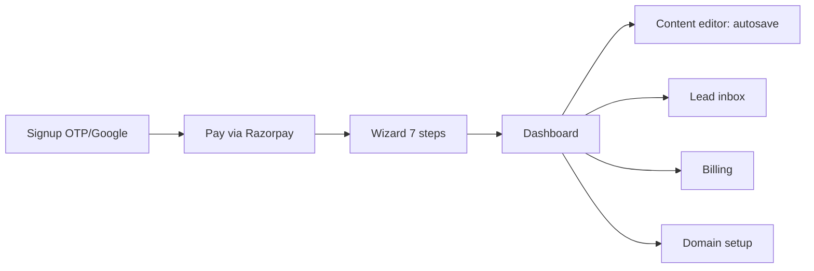

# 08 — UI Spec

## 1. Client site template

Visual direction (ADR-013), taken from the two founder-supplied reference images: clean white header; mint panel behind a bold left-aligned headline; right half is a doctor cut-out photo on a solid green/teal shape with rounded corners; large rounded primary button; poster-style contact rows ("Call us", "Visit website") with round icons; doctor name plate with degree below the photo. Elements from the references that are NOT carried over: "Sign In" button (no accounts on client sites), "Watch a video" (adds JS/bytes; P3), and "Book your Appointment" as a booking system (exclusion; replaced by a wa.me/call link labelled "Book on WhatsApp").

| # | Section | Purpose | Content fields | A11y notes |
|---|---|---|---|---|
| 1 | Sticky mobile CTA bar (bottom) | One-tap contact | phone, whatsapp, form anchor | 48 px targets; `aria-label` "Call Dr. {name}"; hidden ≥ 768 px |
| 2 | Header | Brand + anchor nav | clinic name, nav (Home, Services, About, Clinic, Contact) | Skip link; nav is a `<nav>` with `aria-current` |
| 3 | Hero (split) | Trust + action | headline, 2-line intro, primary CTA (Call), secondary (WhatsApp), photo, name plate "DR. {NAME} ({DEGREE})" | H1 only here; photo `alt` = name + specialty |
| 4 | Credentials & registrations | Verify | degrees[], registration no. + council, years of experience | Definition list |
| 5 | Services grid | What is treated | services[] (title, 1 line) max 9 | List semantics |
| 6 | Clinic info + map | Find the clinic | address, hours[], phone, Maps embed (click-to-load facade) | Map `title`; hours as table |
| 7 | Reviews | Social proof | reviews[] (name initial, text, source) max 6, only genuine consent-obtained | No star-rating schema unless verified |
| 8 | FAQ accordion | Answer objections | faq[] max 8 | `
/
`, zero JS |
| 9 | Contact form | Lead capture | name, phone, message, consent checkbox | Labels, inline errors, `aria-live` |
| 10 | Footer | NAP + legal | name, address, phone, privacy notice, "Website by EcoDigiTech" | NAP identical to JSON-LD |

## 2. Component standards

Theme tokens (two presets; selected by `theme` in the content sheet):

| Token | green (reference 1) | teal (reference 2) |
|---|---|---|
| `--brand` | #15803D | #0F6B63 |
| `--brand-contrast` | #FFFFFF | #FFFFFF |
| `--mint` (panel bg) | #E6F4EC | #D5F0EB |
| `--ink` | #0B1F17 | #0B2A27 |
| `--muted` | #4B5F57 | #44625E |
| Radius | 12 px buttons, 24 px photo shape | same |
| Spacing | 4-pt scale: 4, 8, 12, 16, 24, 32, 48, 64 | same |
| Type scale | 14/16/20/28/40 px (mobile H1 32) | same |

Contrast check: `--brand` on white ≥ 4.5:1 (acceptance via axe).

| Standard | Rule |
|---|---|
| LCP | Hero image is LCP element: AVIF/WebP, `fetchpriority="high"`, no lazy, width/height set, ≤ 60 KB at 640 px width |
| Fonts | Self-hosted variable woff2 (Plus Jakarta Sans, Latin subset ≤ 25 KB); `font-display: swap`; Noto Sans Devanagari subset loaded only when `lang=hi`; system-font fallback stack |
| JS | < 30 KB gzipped total target (budget 170 KB, 02 § 5); form handling and map facade only; no framework runtime on first paint |
| Click-to-call | `<a href="tel:+91XXXXXXXXXX">`; event `call_clicked` (11 § 1) |
| WhatsApp | `<a href="https://wa.me/91XXXXXXXXXX?text=Hello%20Dr.%20{name}%2C%20I%20would%20like%20to%20book%20a%20visit">` |
| Form UX | Inline validation on blur; honeypot field `website`; submit disables button; success state "Thank you, we will call you"; errors map to E-codes: E-1101 invalid phone, E-1501 too many attempts, E-2xxx/E-4xxx show the fallback (mailto/WhatsApp) per 09 § 6 |
| JSON-LD | `Physician` + `MedicalClinic` built with `JSON.stringify` from typed data (never string concatenation) |
| Images | AVIF with WebP fallback; hero 4:5, gallery 16:9; max 150 KB per image; blur placeholder data-URI ≤ 1 KB |

Acceptance: Lighthouse mobile perf ≥ 90, a11y ≥ 95; LCP < 2.0 s, TBT < 200 ms on Moto G-class throttled 4G.

## 3. Platform portal (P2)

Content editor: autosave every 5 s with `version` check. Conflict UX (04 § SD-025): on E-1301 show a banner "This page was changed in another tab" with two buttons, "Reload latest" and "Keep my changes and review differences" (field-level diff), never silent overwrite. Wizard steps: Profile, Credentials, Services, Clinic, Photo, Theme, Review. Portal UI language English only (LANGUAGES variable).

## 4. Live progress

**(SD-054) WebSockets.** *Meaning:* full-duplex connections. *Decision:* rejected for P1/P2 — Vercel functions cannot hold long-lived sockets; P3 may add a managed realtime service for collaborative editing. *Sketch:* none. *Failure:* adopting it forces a stateful server; caught in ADR review. *Verify:* 13 § 2 (architecture review gate).

**(SD-055) SSE.** *Meaning:* one-way server push. *Decision:* build progress via `GET /v1/sites/{id}/events` (SSE) with a 55 s max stream and auto-reconnect (`Last-Event-ID`). Event schema: `event: progress` `data: {"step":"build","pct":60,"at":"2026-11-02T10:00:00+05:30","traceId":"…"}`; final `event: done|failed`. UX: if no event for 15 s show "Status may be out of date — retrying"; after 2 failed reconnects fall back to polling. Rejected: WebSockets. *Failure:* users see stale status; reveals as `sse_reconnect_total` spike. *Verify:* 13 § 2 (E2E publish journey).

**(SD-056) Long polling.** *Meaning:* held HTTP requests. *Decision:* fallback `GET /v1/sites/{id}/status?since=<seq>` with 25 s hold then every 5 s; used when SSE blocked by proxies. Comparison:

| Option | Serverless fit | Cost | Verdict |
|---|---|---|---|
| WebSockets | Poor | High | Rejected (P3 maybe) |
| SSE | Good (≤ 55 s) | Low | Primary |
| Long polling | Good | Medium | Fallback |

*Failure:* excess polling load; alert at 20 req/s on `/status`. *Verify:* 13 § 5.

## 5. Accessibility

WCAG 2.2 AA checklist: contrast ≥ 4.5:1 (3:1 large text/icons); visible focus ring 2 px `--brand`; focus order = DOM order; target size ≥ 24 px (44 px for primary CTAs); no motion > 200 ms and `prefers-reduced-motion` respected; form errors announced via `aria-live="polite"`; language attribute `lang="en"` or `lang="hi"`; consistent help (contact) placement. Gate: axe CI with zero serious violations (13 § 7).

## 6. Content style

English and Hindi: Devanagari uses Noto Sans Devanagari at 16 px minimum with line-height 1.7; mixed script allowed for names/degrees (keep "MBBS" in Latin); numerals in Latin digits. Medical tone: factual, no curative claims, no "guaranteed results", no before/after, no patient testimonials about outcomes; compliance with advertising rules for medical practitioners is DECISION-NEEDED: legal review (recommendation: restrict to qualifications, services, location, timings).
