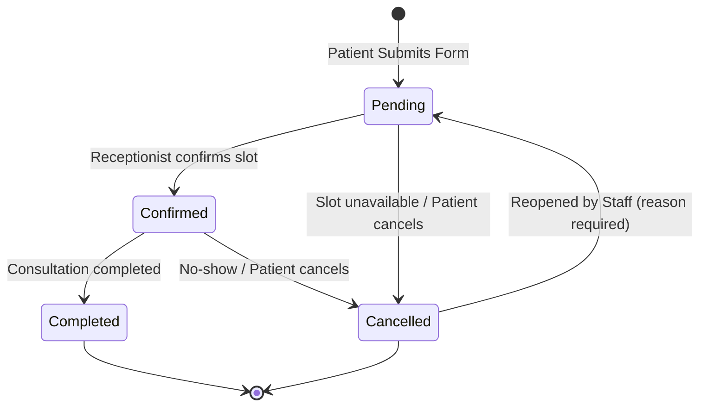
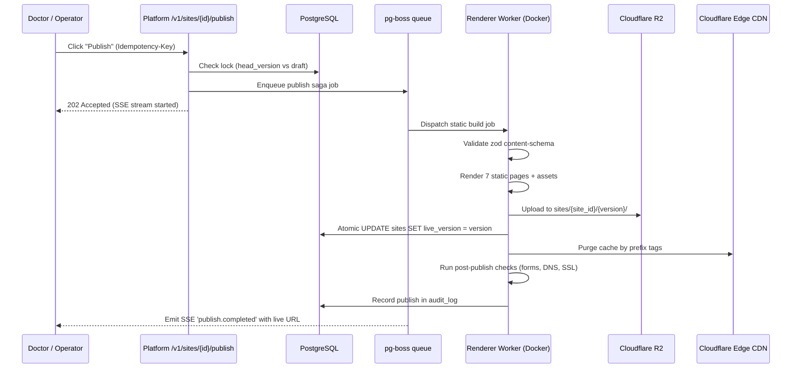

# 18 — CMS Specification

## 1. Roles & Permission Matrix

The platform enforces Role-Based Access Control (RBAC) backed by PostgreSQL Row-Level Security (RLS) on all tenant tables. Every query sets `app.tenant_id`.

| Capability | Platform Superadmin | Agency Operator | Clinic Owner / Doctor (`tenant_owner`) | Clinic Staff / Receptionist (`tenant_staff`) |
|---|---|---|---|---|
| View Submissions (Appointments/Enquiries) | All tenants | Assigned tenants | Own tenant | Own tenant |
| Change Submission Status | Yes | Yes | Yes | Yes |
| Add Internal Notes to Submission | Yes | Yes | Yes | Yes |
| Export Submissions to CSV | Yes | Yes | Yes | Yes |
| Edit Clinic Settings (Hours, Slots) | Yes | Yes | Yes | Yes |
| Configure Notification Emails | Yes | Yes | Yes | Read only |
| Edit Site Content (Draft) | Yes | Yes | Yes | Read only |
| Publish Site to Production | Yes | Yes | Yes | No |
| Rollback Site Version | Yes | Yes | Yes | No |
| Manage Blog Posts (Create/Edit/Publish) | Yes | Yes | Yes | No |
| Manage FAQs & Testimonials | Yes | Yes | Yes | Draft only |
| Moderate Testimonials (Approve) | Yes | Yes | Yes | No |
| Upload & Replace Media Assets | Yes | Yes | Yes | No |
| Manage 2FA & Team Users | Yes | Yes | Yes | No |
| View Billing & Quotas | Yes | Read only | Yes | No |

---

## 2. Content Model

### 2.1 Fixed 7-Page Architecture
The Professional Clinic plan supports up to **7 enabled page slots**. Exceeding 7 pages is rejected with `E-1601`:
1. **Home (`/`):** Hero split section, clinical badge, quick-book trigger, highlights, doctor teaser, clinic timings.
2. **About (`/about`):** Doctor full biography, degrees, medical registration credentials, clinic founding story, philosophy of care.
3. **Services (`/services`):** Comprehensive treatments grid (up to 12 clinical treatments), descriptions, procedure preparation, FAQs per service.
4. **Doctors / Team (`/doctors`):** Multi-doctor or specialist profiles, qualifications, clinical interests, consulting schedules.
5. **Testimonials & FAQ (`/testimonials-faq`):** Verified patient feedback (initials only, consent recorded), searchable categorized FAQs.
6. **Blog (`/blog`):** Patient education articles, seasonal health advisories, post detail pages (`/blog/:slug`). Posts are content entries and do not count toward the 7-page limit.
7. **Contact & Appointments (`/contact`):** Interactive appointment booking form, general enquiry form, clinic address, interactive Google Maps facade, emergency notices.

### 2.2 Content Entity Specifications
- **Posts (Blog):**
  - Fields: `id`, `tenant_id`, `title` (≤ 120 chars), `slug` (unique per tenant, lowercase alphanumeric + hyphens), `excerpt` (≤ 250 chars), `content_json` (ProseMirror/TipTap AST), `cover_image_url` (R2 asset key), `published_at`, `is_published` (boolean), `seo_title`, `seo_description`.
- **FAQs:**
  - Fields: `id`, `tenant_id`, `question` (≤ 200 chars), `answer` (≤ 1,000 chars), `category` (General, Appointments, Billing, Procedures), `display_order` (integer), `is_active` (boolean).
- **Testimonials:**
  - Fields: `id`, `tenant_id`, `patient_initials` (e.g. "R. K.", full names banned for privacy), `review_text` (≤ 400 chars), `rating` (1–5 stars), `treatment` (optional service tag), `consent_recorded` (boolean, mandatory `true`), `moderation_status` (`draft` | `approved` | `archived`), `display_order`.
- **Clinic Settings:**
  - Fields: `operating_hours` (JSON: `{ [day]: { open: "09:00", close: "18:00", closed: boolean } }`), `slot_interval_minutes` (15, 30, 45, or 60 min, default 30), `max_daily_slots` (default 40), `notification_emails` (up to 3 verified addresses), `spam_threshold` (score 1–10), `enabled_pages` (array of strings, max 7).

---

## 3. Submissions Inbox (Appointments & Enquiries)

The CMS provides a unified clinical ERP inbox for front-desk receptionists and doctors.

### 3.1 Inbox Features
- **Today's OPD View:** Fast filtered tab showing all appointments where `preferred_date = CURRENT_DATE`, grouped by time slot.
- **Filtering & Search:** Filter by status (`Pending`, `Confirmed`, `Completed`, `Cancelled`), date range picker, service dropdown. Search patient name or phone number (hashed blind index).
- **Cursor Pagination:** Keyset pagination using `(created_at, id) < ($cursor_time, $cursor_id)`. P99 response < 300 ms with 10,000 seeded rows.
- **Detail Drawer:** Sliding drawer displaying:
  - Patient contact details (decrypted on demand with audit log entry).
  - Consultation service requested, preferred date and time slot.
  - DPDP consent timestamp and source page URL.
  - IP hash and Turnstile verification score.
  - Internal clinical/reception staff notes with auto-save.
  - Status transition action bar.
- **Export:** CSV export streaming decrypted data with HTTP header `Content-Disposition: attachment; filename="clinic-appointments-{date}.csv"`.
- **WhatsApp Integration:** One-click `wa.me` generator:
  `https://wa.me/{phone}?text=Dear%20{PatientName},%20your%20appointment%20at%20{ClinicName}%20is%20Confirmed%20for%20{Date}%20at%20{Time}.`

---

## 4. Rich-Text Editor & Content Sanitization

- **Editor Engine:** TipTap / ProseMirror instance configured in `apps/platform`.
- **Allowed Formats:** Headings (`h2`, `h3` only; `h1` reserved for page title), Paragraphs, Bold, Italic, Bullet lists, Ordered lists, Blockquotes, Hyperlinks (internal or `https://` only, `rel="noopener noreferrer"` enforced).
- **Sanitization Pipeline (R9, R10):**
  - Content validated server-side using `sanitize-html` before persistence.
  - Script tags, style tags, object, embed, iframe (except allowlisted Google Maps), inline `style`, and `on*` event handlers are strictly stripped.
  - Any violation returns `422 E-1607 (Sanitization violation)`.
- **Medical Advertising Guardrails (R10):**
  - Validation bans curative claims ("100% cure guaranteed", "permanent result guaranteed"), before-and-after photo comparisons, and unverified outcome promises.

---

## 5. Media Library & Upload Pipeline

- **Dropzone Interface:** Drag-and-drop file uploader supporting PNG, JPG, WebP, and SVG.
- **Security Validation:**
  - Magic-byte verification (sniffs file header to prevent extension spoofing).
  - Maximum file size: 5 MB.
  - SVG sanitizer: parses XML and removes `<script>`, `<foreignObject>`, and all inline scripts.
- **Processing & Storage:**
  - Files converted to WebP and AVIF formats via `sharp`.
  - Uploaded to Cloudflare R2 bucket with prefix: `assets/{tenant_id}/{uuid}.{ext}`.
- **Per-Card Photo Replace:** Every image asset in the CMS site editor has a 1-click "Replace" button that opens the media library drawer, uploads or selects an existing asset, and live-swaps the reference in the draft content sheet.
- **Quota Tracking:** `usage_counters.storage_bytes` increments on each upload. Warns at 80% (800 MB) of the 1 GB allowance; blocks further uploads with `E-1602` at 1 GB.

---

## 6. Publishing Saga & Versioning

### 6.1 Versioning & Atomic Rollback
- Every publish increments the site version (`v1`, `v2`, `v3`...).
- Historical versions remain stored in R2 under `sites/{site_id}/{version}/`.
- One-click rollback invokes `POST /v1/sites/{id}/rollback` with target `version_id`.
- The rollback executes an atomic pointer update in `sites.live_version`, purges Cloudflare CDN cache, and verifies live health in < 10 seconds without rebuilding.

### 6.2 Scheduled Publishing
- Doctors can schedule future publish times (e.g. for a health camp or holiday hours).
- Enqueued as a delayed job in `pg-boss` with `startAfter: targetTimestamp`.

---

## 7. Audit Trail

The platform maintains an immutable, append-only `audit_log` table:
- **Columns:** `id`, `tenant_id`, `actor_id`, `actor_role`, `action`, `resource_type`, `resource_id`, `diff_json`, `ip_hash`, `user_agent`, `created_at`.
- **Audited Events:**
  - Login, logout, 2FA setup, 2FA verification failures.
  - Appointment and enquiry status changes.
  - Internal notes added or modified.
  - Content draft saved, site published, version rolled back.
  - Blog post created, edited, published, deleted.
  - FAQ and testimonial created, reordered, moderated.
  - Clinic settings and operating hours updated.
  - Data export to CSV requested.
- **Immutability:** PostgreSQL grants allow `INSERT` and `SELECT` only; `UPDATE` and `DELETE` trigger an immediate exception.
